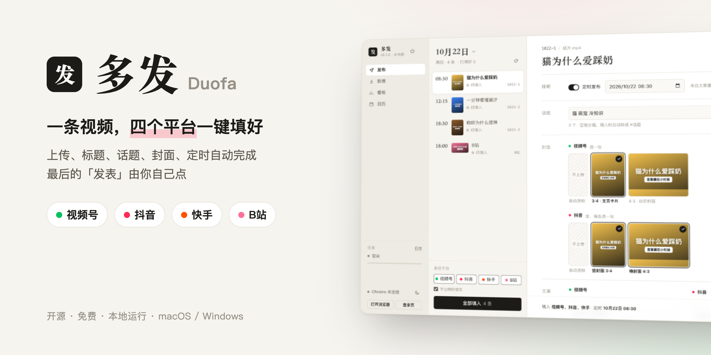
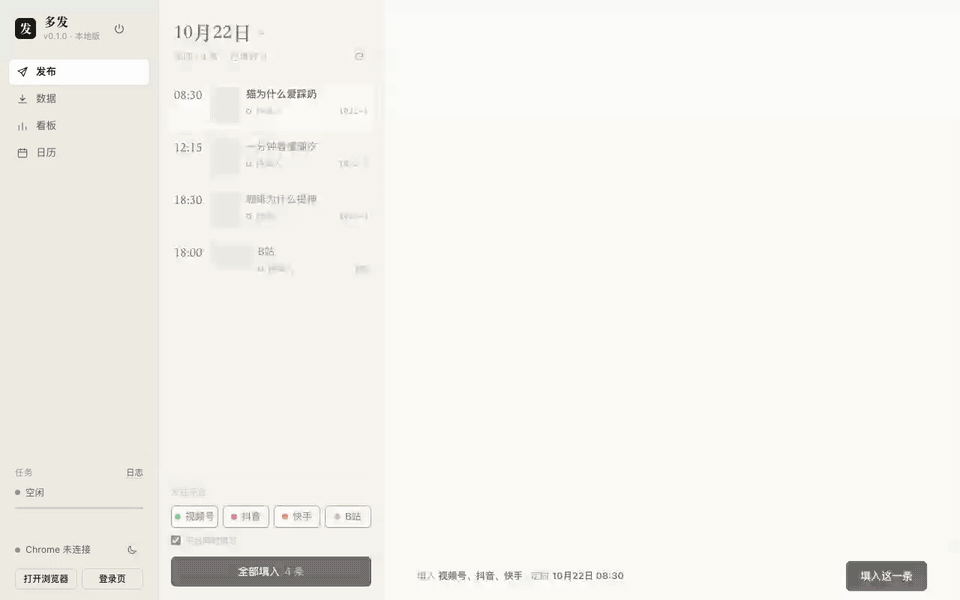
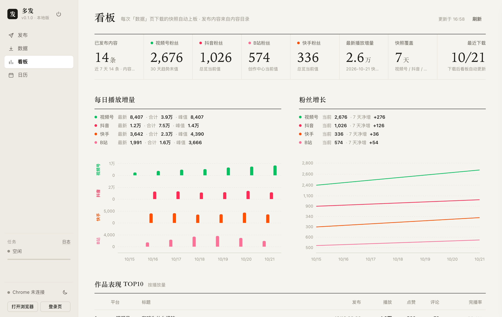

<p align="center">
  
</p>

<p align="center">
  <a href="LICENSE"></a>
  
  
  <a href="https://github.com/cakteam/duofa/actions/workflows/test.yml"></a>
</p>

<p align="center">
  <b>视频号 · 抖音 · 快手 · B站</b>　一键上传、填标题话题、选封面、设定时<br/>
  工具把表单全部填好，最后的「发表」由你自己检查后点
</p>

---

<p align="center"></p>

## 为什么做这个

同一条视频要发四个平台，每个平台都要上传一次、填一遍标题、描述、话题、封面和定时，一条下来十几分钟，还容易填错。
多发把这些重复操作交给浏览器自动完成：**四个平台同时填写，一条内容大约 1 分钟填好**，你只需要逐个标签页看一眼，点「发表」。

## 功能

| | |
| --- | --- |
| 🚀 **一键填表** | 上传视频，填好标题、描述、`#话题`、竖/横封面、定时发布时间。四个平台同时进行，标签页自动改名成「抖音·1101-1·定时08:30·待发布」方便辨认 |
| 🛡 **不会误发** | 工具从不点「发表」。填完后每个平台还会核对一遍：页面把定时或描述重置了会自动补填 |
| 📊 **数据下载** | 读取四个平台后台的作品数据、账号总览、粉丝趋势，存成 Excel 汇总和原始 JSON |
| 📈 **看板** | 每日播放增量、粉丝增长、作品 TOP10；你的每条内容在各平台的播放、点赞、评论、完播率对照着看 |
| 🗓 **日历** | 按月看排期和填表状态，拖动一条到别的日期就是改期 |
| 🔒 **全在本机** | 不上传你的任何数据，没有账号系统；各平台的登录状态只保存在你自己电脑上 |

<table>
  <tr>
    <td width="50%"></td>
    <td width="50%"></td>
  </tr>
  <tr>
    <td align="center">看板（示例数据）</td>
    <td align="center">日历</td>
  </tr>
</table>

## 安装

需要准备：

- **Google Chrome**（[下载](https://www.google.com/chrome/)）。Windows 上没装 Chrome 时会自动改用系统自带的 Edge
- **Node.js 22 或更新版本**（[下载](https://nodejs.org/zh-cn/download)，选「LTS」版本，一路下一步安装即可）

然后下载多发：点本页上方绿色的 **Code → Download ZIP**，解压到任意位置；或者用 git：

```bash
git clone https://github.com/cakteam/duofa.git
```

## 启动

| macOS | Windows |
| --- | --- |
| 双击 **`启动多发.command`** | 双击 **`启动多发.bat`** |
| 如果提示「无法打开」：右键点它 → 打开 | 如果弹出「Windows 已保护你的电脑」：点「更多信息」→「仍要运行」 |

第一次启动会自动安装依赖（需要一两分钟），之后界面会开在一个**独立的 Chrome 窗口**里。这个窗口和你日常用的 Chrome 互不影响。

1. **登录平台**：点左下角「登录页」，在弹出的标签页里分别扫码登录视频号助手、抖音创作者中心、快手创作者服务平台和 B站创作中心。登录一次即可长期有效。
2. **先看看示例**：一开始显示的是自带的示例内容，可以随便点点熟悉界面（示例视频只有 8 秒，别真的发出去）。
3. **退出**：点左上角的电源图标，或直接关掉这个 Chrome 窗口。

> 习惯用命令行的话，也可以在目录里运行 `npm install`，再运行 `npm start`。

## 用自己的内容

把程序目录里的 `config.example.json` 复制一份，改名为 `config.json`，把 `contentDir` 改成你放视频的文件夹，然后重新启动：

macOS：

```json
{ "contentDir": "~/Movies/我的视频" }
```

Windows（路径里的斜杠用 `/`，或者写成两个反斜杠 `\\`）：

```json
{ "contentDir": "D:/视频/我的视频" }
```

内容文件夹按日期分，每条内容一个文件夹（完整说明见 **[docs/内容格式.md](docs/内容格式.md)**）：

```
我的视频/
└── 1101/                        ← 日期目录（1101 或 2026-11-01）
    ├── 1101-1-猫为什么爱踩奶/    ← 一条内容
    │   ├── 成片.mp4
    │   ├── 发布文案.txt
    │   ├── 3x4封面.png          ← 竖封面（可选）
    │   └── 4x3封面.png          ← 横封面（可选）
    └── B站/                     ← 可选：一条 B站内容
        ├── B站.mp4
        ├── B站发布文案.txt
        └── B站封面.png
```

`发布文案.txt` 用【】分段，记事本就能写：

```
【标题】
猫为什么爱踩奶？
答案藏在小时候

【正文】
猫咪踩奶是小时候吃奶时留下的习惯……
#猫 #萌宠 #冷知识

【建议发布时间】
11月1日 08:30
```

## 配置

`config.json` 里可以写这些（都可以不写，用默认值）：

| 配置 | 默认 | 说明 |
| --- | --- | --- |
| `contentDir` | 自带的 `示例内容/` | 内容目录 |
| `dataDir` | 内容目录下的 `数据下载/` | 「数据」页下载的数据存到哪里 |
| `port` | `8686` | 本地服务端口，被占用时改成别的 |
| `channels.hideLocation` | `true` | 视频号的「位置」设为「不显示位置」 |
| `channels.declareOriginal` | `false` | 视频号自动勾选「声明原创」。**只在内容确实是你原创时打开** |

## 常见问题

<details>
<summary><b>提示「未登录」，或者填到一半停了？</b></summary>

平台登录过期了。点「登录页」重新扫码，再填一次。某个平台出问题只会中止它自己，其他平台照常继续。
</details>

<details>
<summary><b>找不到按钮、填表失败？</b></summary>

多半是平台改版了。请到 [Issues](https://github.com/cakteam/duofa/issues) 反馈，附上 `logs/` 里当天的任务日志和截图（发之前看一眼，删掉隐私信息）。
</details>

<details>
<summary><b>定时时间没设上？</b></summary>

时间已经过去，或者超出平台允许的范围（比如 B站只能定 5 分钟到 15 天之内，按 5 分钟一档）。这种情况会保持「立即发表」，由你自己决定。
</details>

<details>
<summary><b>会不会被平台封号？</b></summary>

多发做的是人在网页上的正常操作，而且不会自动发表；但自动化操作是否符合各平台规则，需要你自己判断并承担风险，见下方免责声明。
</details>

<details>
<summary><b>依赖安装失败？</b></summary>

国内网络可以先换成国内镜像，再重新双击启动脚本：

```bash
npm config set registry https://registry.npmmirror.com
```
</details>

## 参与开发

```bash
npm install
npm test
```

| 位置 | 内容 |
| --- | --- |
| `server.js` | 本地服务 |
| `lib/channels.js` `douyin.js` `kuaishou.js` `bilibili.js` | 各平台的填表流程 |
| `lib/data-*.js` | 各平台的数据下载 |
| `lib/parse.js` | 解析内容目录 |
| `public/index.html` | 界面（没有构建步骤） |

欢迎提 Issue 和 Pull Request。

## 免责声明

本工具仅供个人管理自己创作的内容使用。使用自动化工具操作第三方平台可能违反其用户协议，由此产生的账号限制等后果由使用者自行承担。
请勿用于发布侵权、违法或不实内容，也不要对他人的作品勾选「声明原创」。

## 致谢

- 填表选择器早期参考了 [social-auto-upload](https://github.com/dreammis/social-auto-upload)（MIT）
- [Playwright](https://playwright.dev/) · [Chart.js](https://www.chartjs.org/) · [ExcelJS](https://github.com/exceljs/exceljs) · [Express](https://expressjs.com/)

## 许可证

[MIT](LICENSE) © cakteam
